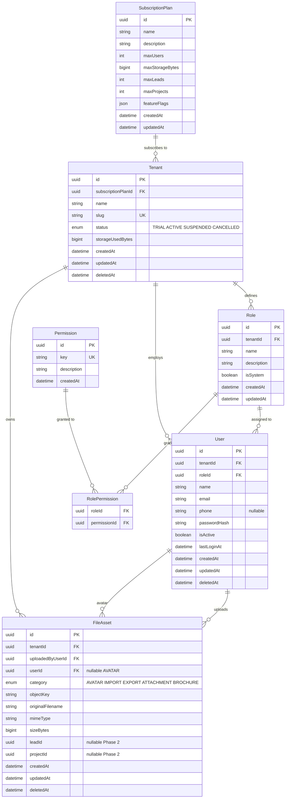

# CRMPro — Database Schema Design

# Overview

This document defines the conceptual database schema for CRMPro.

This is a domain design document, not the final Prisma schema.

Purpose:

- define core entities
- define relationships
- define ownership boundaries
- define constraints
- define domain rules before implementation

CRMPro uses:

- PostgreSQL
- Prisma ORM
- Multi-tenant architecture

---

# Schema Philosophy

The database must prioritize:

- strict tenant isolation
- auditability
- scalability
- explicit relationships
- safe deletions

Critical rule:

All business entities are tenant-scoped unless explicitly stated otherwise.

Cross-tenant data leakage is considered a critical bug.

---

# Domain Overview

Schema is divided into 4 domains:

1. Platform Domain
2. Identity Domain
3. CRM Domain
4. System Domain

---

# Global Rules

---

## IDs

All business entities use UUIDs.

Avoid sequential integer IDs for tenant-owned records.

---

## Timestamps

Most entities include:

- createdAt
- updatedAt

Operational entities may additionally include:

- completedAt
- deletedAt

---

## Soft Delete

Soft deletion is preferred for business entities.

Entities that should support soft delete:

- Tenant
- User
- Project
- Lead
- LeadNote
- FileAsset

Use:

- deletedAt nullable timestamp

Avoid hard deletes unless absolutely necessary.

---

## Storage Accounting

Storage quotas use exact byte values.

- Use `bigint` for all storage size fields
- Never use floating-point GB values for quota accounting

Bad:

- `4.73 GB`

Good:

- `5078792131` bytes

Quota checks compare bytes directly:

```ts
if (
  tenant.storageUsedBytes + uploadSizeBytes >
  subscriptionPlan.maxStorageBytes
) {
  throw new QuotaExceededError();
}
```

- `FileAsset` is the source of truth for stored files
- `Tenant.storageUsedBytes` is a cached aggregate for fast quota checks

See [Storage Accounting Flow](#storage-accounting-flow) for upload/delete behavior.

---

## Tenant Isolation Rule

Every tenant-owned query must include tenant filter.

Safe example:

```ts
where: {
  tenantId;
}
```

Unsafe example:

```ts
findMany();
```

---

# 1. Platform Domain

Platform-level SaaS entities.

---

## SubscriptionPlan

Defines available platform plans.

Examples:

- Starter
- Growth
- Enterprise

Fields:

- id
- name
- description
- maxUsers
- maxStorageBytes (bigint)
- maxLeads
- maxProjects
- featureFlags
- createdAt
- updatedAt

Rules:

- Managed by platform admin
- Shared across tenants
- Defines usage limits and feature access
- Storage limits are enforced in bytes, not GB

Relationship:

SubscriptionPlan → many Tenants

---

## Tenant

Represents a subscribed agency.

Examples:

- Brokerage company
- Real estate agency

Fields:

- id
- name
- slug
- status
- subscriptionPlanId
- storageUsedBytes (bigint)
- createdAt
- updatedAt
- deletedAt

Statuses:

- TRIAL
- ACTIVE
- SUSPENDED
- CANCELLED

Rules:

- Tenant must always have a subscription
- Tenant cannot exist without a plan
- Suspended tenants cannot access system
- `storageUsedBytes` is a cached aggregate; `FileAsset` is the source of truth

Relationships:

Tenant → one SubscriptionPlan
Tenant → many Users
Tenant → many Roles
Tenant → many FileAssets
Tenant → many Projects
Tenant → many Leads
Tenant → many AuditLogs
Tenant → many ImportJobs
Tenant → many ExportJobs

---

## Storage Accounting Flow

CRMPro uses AWS S3 for blob storage. S3 stores objects only — it does not track tenant ownership, business relationships, soft deletion, permissions, or quota accounting. The database owns that metadata via `FileAsset`.

### Upload flow

1. Upload file to S3 (bucket from `AWS_S3_BUCKET`, key from generated `objectKey`)
2. Create `FileAsset` row
3. Increment `Tenant.storageUsedBytes` by `FileAsset.sizeBytes`

### Delete flow

1. Delete S3 object (bucket from `AWS_S3_BUCKET`, key from `FileAsset.objectKey`)
2. Soft delete `FileAsset` (`deletedAt`)
3. Decrement `Tenant.storageUsedBytes` by `FileAsset.sizeBytes`

### Source of truth vs cache

| Concern | Source |
| --- | --- |
| Which files exist, who owns them, business links | `FileAsset` |
| Fast quota checks without aggregating every file | `Tenant.storageUsedBytes` |

`Tenant.storageUsedBytes` must stay in sync with non-deleted `FileAsset` rows. Reconciliation jobs may be added later if drift is detected.

---

# 2. Identity Domain

Authentication and authorization.

---

## Permission

Atomic permission.

Examples:

- lead.create
- lead.assign
- project.update
- user.manage

Fields:

- id
- key
- description
- createdAt

Rules:

- Global entity
- Platform-managed
- Seeded by system
- Permission key encodes module/resource (e.g. `lead.create`, `project.update`); no separate `module` field

Relationship:

Permission ↔ many Roles

---

## Role

Tenant-specific role.

Examples:

System roles:

- Owner
- Manager
- Agent

Custom roles:

- Senior Sales
- Team Lead
- Viewer

Fields:

- id
- tenantId
- name
- description
- isSystem
- createdAt
- updatedAt

Rules:

- Tenant-specific
- Tenants can create custom roles
- Role name is not authorization source
- Permissions are authorization source

Relationships:

Role → one Tenant
Role ↔ many Permissions
Role → many Users

---

## User

Represents CRM users.

Examples:

- owner
- manager
- sales agent

Fields:

- id
- tenantId
- roleId
- name
- email
- phone (nullable)
- passwordHash
- isActive
- lastLoginAt
- createdAt
- updatedAt
- deletedAt

Rules:

- User belongs to exactly one tenant
- User has exactly one role in MVP
- Email uniqueness is tenant-scoped
- `phone` is optional — not every agency user has a phone (e.g. admin, finance, owner)
- Profile images are **not** stored on `User`; use `FileAsset` with `category = AVATAR` (see [FileAsset](#fileasset))

Database constraint (required in Prisma):

```prisma
@@unique([tenantId, email])
```

Relationships:

User → one Tenant
User → one Role
User → many Uploaded FileAssets
User → many Avatar FileAssets (via `FileAsset.userId`, `category = AVATAR`)
User → many Assigned Leads
User → many Audit Logs
User → many Lead Activities
User → many Lead Notes

---

# 3. CRM Domain

Core CRM functionality.

---

## Project

Represents real estate projects / compounds.

Examples:

- Palm Hills
- Badya
- Mountain View

Projects are developments, not unit inventory.

Fields:

- id
- tenantId
- name
- developer
- location
- description
- isActive
- createdAt
- updatedAt
- deletedAt

Relationships:

Project → one Tenant
Project ↔ many Leads
Project → many FileAssets

---

## LeadSource

Tenant-configurable source.

Examples:

- Facebook Ads
- Website
- WhatsApp
- Referral
- Call Center

Fields:

- id
- tenantId
- name
- createdAt
- updatedAt

Rules:

- Tenant-specific
- Fully customizable

Relationships:

LeadSource → one Tenant
LeadSource → many Leads

---

## PipelineTemplate

Platform-level predefined pipeline template.

Examples:

Residential Sales Template:

- New
- Contacted
- Qualified
- Negotiating
- Won
- Lost

Commercial Leasing Template:

- New
- Viewing Scheduled
- Proposal Sent
- Contract Pending
- Closed

Fields:

- id
- name
- description
- createdAt

Rules:

- Platform-managed
- Used during tenant onboarding

Relationship:

PipelineTemplate → many PipelineTemplateStages

---

## PipelineTemplateStage

Fields:

- id
- templateId
- name
- color
- order

Relationships:

PipelineTemplateStage → one PipelineTemplate

---

## PipelineStage

Tenant-specific pipeline stage.

Fields:

- id
- tenantId
- name
- color
- order
- isSystem
- createdAt
- updatedAt

Rules:

- Tenant-owned
- New tenants receive default stages from template
- Tenants can:
  - rename stages
  - reorder stages
  - add stages
  - remove stages

Relationships:

PipelineStage → one Tenant
PipelineStage → many Leads

---

## Lead

Core CRM entity.

Represents customer/prospect.

Fields:

- id
- tenantId
- sourceId
- pipelineStageId
- assignedUserId
- fullName
- primaryPhone
- secondaryPhone
- email
- budgetMin
- budgetMax
- notesSummary
- lastContactedAt
- createdAt
- updatedAt
- deletedAt

Rules:

- Tenant-owned
- Lead may be interested in multiple projects
- Lead may be assigned to one user

Relationships:

Lead → one Tenant
Lead → one LeadSource
Lead → one PipelineStage
Lead → one Assigned User (nullable)
Lead ↔ many Projects
Lead → many FileAssets
Lead → many LeadActivities
Lead → many LeadNotes

---

## LeadActivity

Canonical timeline feed.

Examples:

System-generated:

- lead created
- lead updated
- assignment changed
- stage changed
- project linked
- project unlinked

User-triggered:

- note added
- call logged
- meeting logged

Fields:

- id
- tenantId
- leadId
- actorUserId
- eventType
- metadata (JSON)
- createdAt

Event examples:

- CREATED
- UPDATED
- ASSIGNED
- STAGE_CHANGED
- NOTE_ADDED
- CALL_LOGGED
- MEETING_LOGGED

Rules:

- Timeline is append-only
- Never edited
- Chronological activity source of truth

Relationships:

LeadActivity → one Tenant
LeadActivity → one Lead
LeadActivity → one User (nullable for system events)

---

## LeadNote

Internal comments/notes.

Examples:

- client wants installment plan
- prefers ready-to-move units
- follow up next week

Fields:

- id
- tenantId
- leadId
- authorId
- content
- createdAt
- updatedAt
- deletedAt

Relationships:

LeadNote → one Tenant
LeadNote → one Lead
LeadNote → one User

---

# 4. System Domain

Operational entities.

---

## FileAsset

Tracks all uploaded files stored in AWS S3.

S3 holds blobs and object metadata only. The database tracks tenant ownership, business relationships, soft deletion, permissions context, and quota accounting.

Examples:

- lead attachments
- project brochures
- project images
- CSV imports
- exported files
- future call recordings

Fields:

- id
- tenantId
- uploadedByUserId
- category (enum)
- objectKey
- originalFilename
- mimeType
- sizeBytes (bigint)
- userId (nullable)
- leadId (nullable)
- projectId (nullable)
- createdAt
- updatedAt
- deletedAt

Category enum:

- `AVATAR` — user profile images (`userId` required)
- `IMPORT` — CSV and other bulk import files
- `EXPORT` — generated export downloads
- `ATTACHMENT` — lead or project attachments
- `BROCHURE` — project brochures and marketing assets (`projectId` required in Phase 2)

Rules for `category`:

- Set at upload time; required on every `FileAsset`
- Use for filtering and reporting — never infer file purpose from `objectKey` path patterns

Example:

```ts
// Good
where: { tenantId, category: 'EXPORT' }

// Bad
where: { objectKey: { contains: 'exports' } }
```

### Link FK rules by category (application validation)

`leadId`, `projectId`, and `userId` cannot be fully enforced in Prisma alone. Validate at the API layer on create/update.

| Category | `userId` | `leadId` | `projectId` |
| --- | --- | --- | --- |
| `AVATAR` | required | must be null | must be null |
| `IMPORT` | must be null | must be null | must be null |
| `EXPORT` | must be null | must be null | must be null |
| `ATTACHMENT` | must be null | exactly one of `leadId` or `projectId` | exactly one of `leadId` or `projectId` |
| `BROCHURE` | must be null | must be null | required (Phase 2) |

`ATTACHMENT` XOR rule:

- Valid: `leadId` set, `projectId` null
- Valid: `leadId` null, `projectId` set
- Invalid: both null — attachment belongs to nothing
- Invalid: both set — ambiguous ownership

`AVATAR` replaces `User.avatarUrl`. Resolve a user's avatar by querying non-deleted `FileAsset` rows where `category = AVATAR` and `userId` matches. Prefer the latest upload if multiple exist (or enforce one active avatar in application logic).

S3 configuration:

- Bucket is static per environment (not stored per row)
- Resolved from config: `AWS_S3_BUCKET`
- Examples: `crmpro-dev-assets`, `crmpro-prod-assets`

`objectKey` is the only S3 location identifier stored in the database.

Example:

```text
tenants/t1/leads/l1/id-card.pdf
```

Rules:

- `FileAsset` is the source of truth for stored files
- `Tenant.storageUsedBytes` is a cached aggregate updated on upload/delete
- Soft deletion is supported via `deletedAt`
- Use explicit nullable foreign keys (`leadId`, `projectId`)
- Do not use polymorphic `entityType` / `entityId` relations
- Do not store `bucket` on each row; bucket comes from environment config

Relationships:

FileAsset → one Tenant
FileAsset → one Uploaded User
FileAsset → optional User (avatar subject via `userId`)
FileAsset → optional Lead
FileAsset → optional Project

### Product note: upload constraints (not schema)

File upload limits are product rules enforced at the API layer — not stored as database columns.

Plan-based constraints may include:

- max single upload size
- allowed MIME types per `FileAsset.category`

Examples:

| Plan | Max single file size |
| --- | --- |
| Starter | 25 MB |
| Growth | (TBD) |
| Enterprise | 250 MB |

Enforcement happens before S3 upload:

1. Resolve tenant's `SubscriptionPlan`
2. Validate file size and MIME type against plan rules
3. Reject upload if constraints are exceeded

`SubscriptionPlan.featureFlags` or dedicated plan fields may define these limits when implemented. Document final values in product/billing docs when plans are finalized.

---

## AuditLog

System-level audit trail.

Examples:

- user created
- role updated
- permission changed
- lead deleted

Fields:

- id
- tenantId
- actorUserId
- entityType
- entityId
- action
- metadata (JSON)
- createdAt

Rules:

- Immutable
- Never edited
- Critical for accountability

Relationships:

AuditLog → one Tenant
AuditLog → one User (actor)

---

## ImportJob

Bulk import tracker.

Examples:

- leads CSV import
- projects import

Fields:

- id
- tenantId
- createdByUserId
- status
- fileUrl
- totalRows
- processedRows
- successfulRows
- failedRows
- errorSummary
- createdAt
- completedAt

Statuses:

- PENDING
- PROCESSING
- COMPLETED
- FAILED

Relationships:

ImportJob → one Tenant
ImportJob → one User

---

## ExportJob

Export tracker.

Fields:

- id
- tenantId
- createdByUserId
- status
- fileUrl
- createdAt
- completedAt

Statuses:

- PENDING
- PROCESSING
- COMPLETED
- FAILED

Relationships:

ExportJob → one Tenant
ExportJob → one User

---

# MVP Exclusions

Not included yet:

- AI assistant
- WhatsApp sync
- Meta Ads sync
- Google Ads sync
- call recordings
- property unit inventory
- commission management

---

# Entity Relationship Diagram (Phase 1)

Foundation entities only: `SubscriptionPlan`, `Tenant`, `Permission`, `Role`, `User`, `RolePermission`, and `FileAsset`.

Notes:

- `FileAsset.leadId` and `FileAsset.projectId` are Phase 2 CRM FKs — relations not drawn here
- `FileAsset.userId` links `AVATAR` files to a `User` (replaces `User.avatarUrl`)
- S3 bucket is **not** stored per row; resolved from `AWS_S3_BUCKET` at runtime
- Upload size / MIME limits are product rules (see [upload constraints](#product-note-upload-constraints-not-schema)) — not schema fields
- `@@unique([tenantId, email])` on `User` is a required database constraint
- `FileAsset` link FK rules by `category` are application validation — see [link FK rules](#link-fk-rules-by-category-application-validation)


