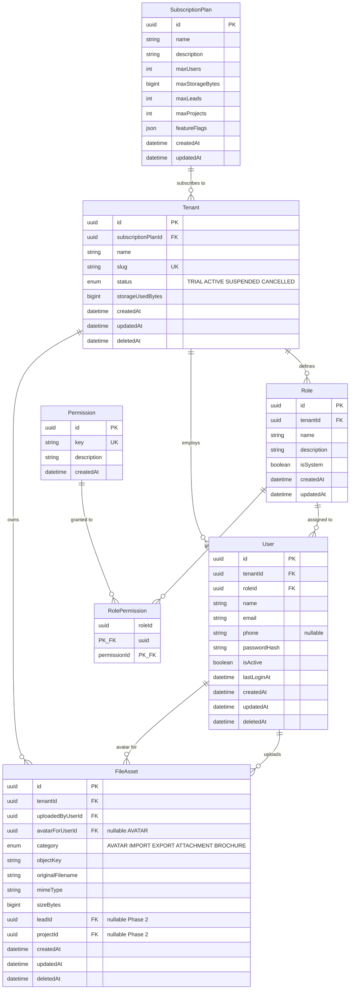
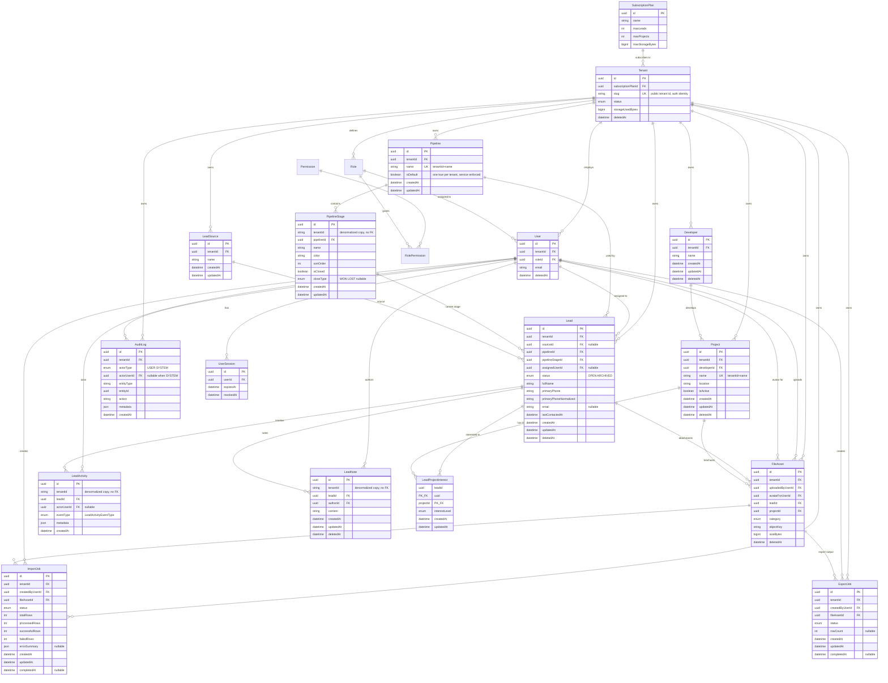

# CRMPro — Database Schema Design

# Overview

This document defines the conceptual database schema for CRMPro.

This is a domain design document, not the final Prisma schema.

Purpose:

- define core entities
- define relationships
- define ownership boundaries
- define constraints
- define domain rules before implementation

CRMPro uses:

- PostgreSQL
- Prisma ORM
- Multi-tenant architecture

---

# Schema Philosophy

The database must prioritize:

- strict tenant isolation
- auditability
- scalability
- explicit relationships
- safe deletions

Critical rule:

All business entities are tenant-scoped unless explicitly stated otherwise.

Cross-tenant data leakage is considered a critical bug.

---

# Domain Overview

Schema is divided into 4 domains:

1. Platform Domain
2. Identity Domain
3. CRM Domain
4. System Domain

---

# Global Rules

---

## Onboarding

When a tenant is created:

1. Tenant row is created
2. Default roles are seeded
3. Default permissions are assigned
4. One default pipeline is created
5. Default pipeline stages are created
6. Owner user is created

---

## IDs

All business entities use UUIDs.

Avoid sequential integer IDs for tenant-owned records.

---

## Timestamps

All domain entities include:

- createdAt
- updatedAt

Standard across CRM and system entities, including:

- Project, LeadSource, Pipeline, PipelineStage
- Lead, LeadProjectInterest, LeadNote
- ImportJob, ExportJob
- Developer

Append-only / immutable entities use `createdAt` only (no `updatedAt`):

- LeadActivity
- AuditLog

Operational entities may additionally include:

- completedAt
- deletedAt

Timestamps support sorting, analytics, SLA tracking, and dashboards — especially on `Lead`.

---

## Denormalized `tenantId`

Some entities store `tenantId` even though tenant ownership is already reachable through a parent relation.

Examples:

```text
PipelineStage → Pipeline → Tenant
LeadActivity  → Lead → Tenant
LeadNote      → Lead → Tenant
```

### Real FK vs denormalized copy

| Pattern | Entities | `tenantId` in DB |
| ------- | -------- | -------------- |
| **Real foreign key** | `Pipeline`, `Lead`, `Project`, `LeadSource`, `FileAsset`, `AuditLog`, `ImportJob`, `ExportJob`, `Developer`, `Role`, `User` | FK to `Tenant` — draw `Tenant \|\|--o{ Entity` in ERD |
| **Denormalized copy (no FK)** | `PipelineStage`, `LeadActivity`, `LeadNote` | Plain column — **not** a Prisma/DB relation |

On denormalized tables:

- `tenantId` is a **cached copy** for fast filtering and composite indexes
- **No database foreign key** to `Tenant`
- Application layer sets `tenantId` from the parent on create and validates on update
- ERD shows **no** `Tenant → PipelineStage` (or similar) line — ownership is via the parent chain only

`tenantId` is denormalized on these tables for:

- fast tenant-scoped queries without extra joins
- simpler Prisma `where: { tenantId }` filters
- composite indexes such as `(tenantId, createdAt)`

**Application rule:** denormalized `tenantId` must always match the parent chain.

Examples:

- `pipelineStage.tenantId === pipeline.tenantId`
- `leadActivity.tenantId === lead.tenantId`
- `leadNote.tenantId === lead.tenantId`

Prisma shape (denormalized — no `@relation` on `tenantId`):

```prisma
model PipelineStage {
  tenantId String @db.Uuid // denormalized copy — not a relation
  pipeline Pipeline @relation(fields: [pipelineId], references: [id])
  // ...
}
```

---

## Unique Constraints

Required or strongly recommended uniqueness rules.

| Entity | Constraint | Notes |
| ------ | ---------- | ----- |
| `Tenant` | `slug` unique | Already required |
| `Permission` | `key` unique | Global |
| `User` | `@@unique([tenantId, email])` | Tenant-scoped login |
| `Role` | `@@unique([tenantId, name])` | No duplicate "Manager" per tenant |
| `Developer` | `@@unique([tenantId, name])` | No duplicate developer names |
| `Project` | `@@unique([tenantId, name])` | No accidental duplicate project names per tenant |
| `Pipeline` | `@@unique([tenantId, name])` | No duplicate pipeline names |
| `LeadSource` | `@@unique([tenantId, name])` | No duplicate source names |
| `PipelineStage` | `@@unique([pipelineId, sortOrder])` | No two stages at same position |
| `PipelineStage` | `@@unique([pipelineId, name])` | Recommended — no duplicate stage names in one pipeline |
| `LeadProjectInterest` | `@@unique([leadId, projectId])` | Composite PK |

---

## Recommended Indexes

Define hot-query indexes at schema design time. CRM list and timeline queries are index-sensitive at scale.

### Leads list

Typical filters: `tenantId`, `pipelineId`, `pipelineStageId`, `assignedUserId`, `createdAt`, `status`.

```prisma
@@index([tenantId, pipelineStageId, assignedUserId])
@@index([tenantId, createdAt(sort: Desc)])
@@index([tenantId, status])
@@index([tenantId, primaryPhoneNormalized]) // dedupe / search
```

### Lead activity timeline

```prisma
@@index([leadId, createdAt(sort: Desc)])
@@index([tenantId, createdAt(sort: Desc)]) // on LeadActivity denormalized tenantId
```

### Audit logs

```prisma
@@index([tenantId, createdAt(sort: Desc)])
```

### Pipeline stages

```prisma
@@index([tenantId])              // denormalized copy — fast tenant filter
@@index([pipelineId, sortOrder])
```

### File assets

```prisma
@@index([tenantId, category])
@@index([leadId])
@@index([projectId])
objectKey String @unique         // globally unique S3 key — lookup + dedupe
```

### Background jobs

```prisma
@@index([status])                // worker: WHERE status = PENDING
@@index([tenantId])
```

---

## Soft Delete

Soft deletion is preferred for business entities.

Entities that should support soft delete:

- Tenant
- User
- Developer
- Project
- Lead
- LeadNote
- FileAsset

Use:

- deletedAt nullable timestamp

Avoid hard deletes unless absolutely necessary.

---

## Storage Accounting

Storage quotas use exact byte values.

- Use `bigint` for all storage size fields
- Never use floating-point GB values for quota accounting

Bad:

- `4.73 GB`

Good:

- `5078792131` bytes

Quota checks compare bytes directly:

```ts
if (
  tenant.storageUsedBytes + uploadSizeBytes >
  subscriptionPlan.maxStorageBytes
) {
  throw new QuotaExceededError();
}
```

- `FileAsset` is the source of truth for stored files
- `Tenant.storageUsedBytes` is a cached aggregate for fast quota checks

See [Storage Accounting Flow](#storage-accounting-flow) for upload/delete behavior.

---

## Tenant Isolation Rule

Every tenant-owned query must include tenant filter.

Safe example:

```ts
where: {
  tenantId;
}
```

Unsafe example:

```ts
findMany();
```

---

# 1. Platform Domain

Platform-level SaaS entities.

---

## SubscriptionPlan

Defines available platform plans.

Examples:

- Starter
- Growth
- Enterprise

Fields:

- id
- name
- description
- maxUsers
- maxStorageBytes (bigint)
- maxLeads
- maxProjects
- featureFlags
- createdAt
- updatedAt

Rules:

- Managed by platform admin
- Shared across tenants
- Defines usage limits and feature access
- Storage limits are enforced in bytes, not GB

Relationship:

SubscriptionPlan → many Tenants

---

## Tenant

Represents a subscribed agency.

Examples:

- Brokerage company
- Real estate agency

Fields:

- id
- name
- slug
- status
- subscriptionPlanId
- storageUsedBytes (bigint)
- createdAt
- updatedAt
- deletedAt

Statuses:

- TRIAL
- ACTIVE
- SUSPENDED
- CANCELLED

Rules:

- Tenant must always have a subscription
- Tenant cannot exist without a plan
- Suspended tenants cannot access system
- `storageUsedBytes` is a cached aggregate; `FileAsset` is the source of truth
- **`slug` is the public tenant identifier** — globally unique (`@@unique` on `slug`)
- Login uses `tenantSlug` (e.g. `"prime-estates"`) — slug is part of auth identity alongside email/password
- Multi-region future: same company may operate separate regional tenants (e.g. `acme-eg`, `acme-sa`); globally unique slug supports this without schema change

Relationships:

Tenant → one SubscriptionPlan
Tenant → many Users
Tenant → many Roles
Tenant → many FileAssets
Tenant → many Developers
Tenant → many Projects
Tenant → many LeadSources
Tenant → many Pipelines
Tenant → many Leads
Tenant → many AuditLogs
Tenant → many ImportJobs
Tenant → many ExportJobs

---

## Storage Accounting Flow

CRMPro uses AWS S3 for blob storage. S3 stores objects only — it does not track tenant ownership, business relationships, soft deletion, permissions, or quota accounting. The database owns that metadata via `FileAsset`.

### Upload flow

1. Upload file to S3 (bucket from `AWS_S3_BUCKET`, key from generated `objectKey`)
2. Create `FileAsset` row
3. Increment `Tenant.storageUsedBytes` by `FileAsset.sizeBytes`

### Delete flow

1. Delete S3 object (bucket from `AWS_S3_BUCKET`, key from `FileAsset.objectKey`)
2. Soft delete `FileAsset` (`deletedAt`)
3. Decrement `Tenant.storageUsedBytes` by `FileAsset.sizeBytes`

### Source of truth vs cache

| Concern                                          | Source                    |
| ------------------------------------------------ | ------------------------- |
| Which files exist, who owns them, business links | `FileAsset`               |
| Fast quota checks without aggregating every file | `Tenant.storageUsedBytes` |

`Tenant.storageUsedBytes` must stay in sync with non-deleted `FileAsset` rows. Reconciliation jobs may be added later if drift is detected.

---

# 2. Identity Domain

Authentication and authorization.

---

## Permission

Atomic permission.

Examples:

- lead.create
- lead.assign
- project.update
- user.manage

Fields:

- id
- key
- description
- createdAt

Rules:

- Global entity
- Platform-managed
- Seeded by system
- Permission key encodes module/resource (e.g. `lead.create`, `project.update`); no separate `module` field

Relationship:

Permission ↔ many Roles

---

## Role

Tenant-specific role.

Examples:

System roles:

- Owner
- Manager
- Agent

Custom roles:

- Senior Sales
- Team Lead
- Viewer

Fields:

- id
- tenantId
- name
- description
- isSystem
- createdAt
- updatedAt

Rules:

- Tenant-specific
- Tenants can create custom roles
- Role name is not authorization source
- Permissions are authorization source
- Role name unique per tenant: `@@unique([tenantId, name])`

Relationships:

Role → one Tenant
Role ↔ many Permissions
Role → many Users

---

## User

Represents CRM users.

Examples:

- owner
- manager
- sales agent

Fields:

- id
- tenantId
- roleId
- name
- email
- phone (nullable)
- passwordHash
- isActive
- lastLoginAt
- createdAt
- updatedAt
- deletedAt

Rules:

- User belongs to exactly one tenant
- User has exactly one role in MVP
- Email uniqueness is tenant-scoped
- `phone` is optional — not every agency user has a phone (e.g. admin, finance, owner)
- Profile images are **not** stored on `User`; use `FileAsset` with `category = AVATAR` (see [FileAsset](#fileasset))

Database constraint (required in Prisma):

```prisma
@@unique([tenantId, email])
```

### Soft-delete and email uniqueness

`@@unique([tenantId, email])` applies to **all** rows including soft-deleted users.

Implication: a soft-deleted user still occupies that email within the tenant.

```text
User deleted (deletedAt set)
→ recreate user with same email
→ DB unique constraint fails
```

**Policy:** restore the existing user row instead of creating a new one with the same email. Do not use partial unique indexes on `deletedAt IS NULL` for MVP — keep the hard unique and handle reactivation in the service layer.

**User management UI must support this.** When an admin tries to add a user whose email belongs to a soft-deleted account:

- Offer **Restore deleted user** (clear `deletedAt`, update fields) — preferred
- Or **Hard delete** the old row first (rare, destructive) — only if product explicitly allows permanent removal

Do not show a generic "email already exists" error without a restore path — that is a product bug given this constraint.

Relationships:

User → one Tenant
User → one Role
User → many Uploaded FileAssets (via `FileAsset.uploadedByUserId`)
User → many Avatar FileAssets (via `FileAsset.avatarForUserId`, `category = AVATAR`)
User → many Assigned Leads
User → many Audit Logs
User → many Lead Activities
User → many Lead Notes

---

# 3. CRM Domain

Core CRM functionality.

---

## Developer

Represents a real estate developer tracked by a tenant.

Examples:

- Palm Hills
- Emaar
- Talaat Moustafa

Tenants often manage **many projects from the same developer**. A dedicated entity avoids duplicating developer names as plain strings on every project and enables reporting (projects per developer, lead interest by developer, filters, analytics).

MENA real estate is highly developer-centric (e.g. Emaar Misr, Palm Hills, Talaat Moustafa Group). Agents routinely filter and group by developer — a first-class entity is justified over a plain string on `Project`.

Fields:

- id
- tenantId
- name
- createdAt
- updatedAt
- deletedAt

Rules:

- Tenant-owned
- Name unique per tenant: `@@unique([tenantId, name])`
- Soft-deletable

Relationships:

Developer → one Tenant
Developer → many Projects

---

## Project

Represents real estate projects / compounds.

Examples:

- Badya
- Mountain View iCity
- New Giza

Projects are developments, not unit inventory.

Fields:

- id
- tenantId
- developerId
- name
- location
- description
- isActive
- createdAt
- updatedAt
- deletedAt

Rules:

- Tenant-owned
- Belongs to one developer (`developerId` required)
- Name unique per tenant: `@@unique([tenantId, name])` — prevents accidental duplicates (e.g. two "Mountain View" rows)
- Leads can be interested in multiple projects
- Project can have many interested leads

Relationships:

Project → one Tenant
Project → one Developer
Project → many FileAssets
Project → many LeadProjectInterests

## LeadSource

Tenant-configurable source.

Examples:

- Facebook Ads
- Website
- WhatsApp
- Referral
- Call Center

Fields:

- id
- tenantId
- name
- createdAt
- updatedAt

Rules:

- Tenant-specific
- Fully customizable
- Name unique per tenant: `@@unique([tenantId, name])`

Relationships:

LeadSource → one Tenant
LeadSource → many Leads

---

## Default Pipeline Bootstrap

When a new tenant is created, the system automatically creates one default pipeline.

Default stages:

- New Lead
- Contacted
- Qualified
- Interested
- Negotiation
- Won
- Lost

This default pipeline template is stored in application seed/bootstrap logic,
not as database entities.

After tenant creation, the tenant fully owns the pipeline and may customize:

- pipeline name
- stage names
- stage colors
- stage sort order
- number of stages
- closed-stage semantics (`isClosed`, `closeType`)

Default closed stages on bootstrap:

| Stage       | isClosed | closeType |
| ----------- | -------- | --------- |
| Won         | true     | WON       |
| Lost        | true     | LOST      |
| All others  | false    | null      |

## Pipeline

Tenant-specific pipeline.

Examples:

- Residential Sales
- Commercial Leasing
- Resale

Fields:

- id
- tenantId
- name
- isDefault
- createdAt
- updatedAt

Rules:

- Tenant can have multiple pipelines
- Every lead belongs to one pipeline
- New tenants automatically receive one default pipeline
- Name unique per tenant: `@@unique([tenantId, name])`

### `isDefault` service invariant

`isDefault` is a boolean column — the database cannot enforce "exactly one default per tenant" with a normal unique constraint.

**Service rule:** per tenant, exactly one pipeline may have `isDefault = true`.

When setting a pipeline as default:

1. Unset `isDefault` on the current default pipeline for that tenant
2. Set `isDefault = true` on the new default

Perform both steps in a transaction. Never allow two defaults per tenant.

Relationships:

Pipeline → one Tenant
Pipeline → many PipelineStages
Pipeline → many Leads

## PipelineStage

Tenant-specific pipeline stage.

Fields:

- id
- tenantId — denormalized copy, **not a FK** (see [Denormalized tenantId](#denormalized-tenantid))
- pipelineId
- name
- color
- sortOrder
- isSystem
- isClosed
- closeType (nullable enum)
- createdAt
- updatedAt

`closeType` enum (`PipelineCloseType`):

- WON
- LOST

Rules:

- Belongs to one pipeline (logical ownership: `Pipeline → PipelineStage`)
- `tenantId` is a denormalized copy — no DB FK to `Tenant`; must equal `pipeline.tenantId` (application-enforced)
- `@@unique([pipelineId, sortOrder])` — no two stages at the same position
- `@@unique([pipelineId, name])` — recommended, no duplicate stage names within a pipeline
- Tenants can:
  - rename stages
  - reorder stages (`sortOrder`)
  - add stages
  - remove stages (non-system stages only)
- **Closed-stage semantics:** use `isClosed` and `closeType` — never hardcode stage names like `"Won"` in application logic

Closed stage rules:

- `isClosed = false` → `closeType` must be null (open stage)
- `isClosed = true` → `closeType` must be `WON` or `LOST`
- Default bootstrap sets Won/Lost as closed stages

Relationships:

PipelineStage → one Pipeline
PipelineStage → many Leads

## Lead

Core CRM entity.

Represents customer/prospect.

Fields:

- id
- tenantId
- sourceId (nullable)
- pipelineId
- pipelineStageId
- assignedUserId (nullable)
- status
- fullName (required)
- primaryPhone (required) — user-entered / raw value as captured
- primaryPhoneNormalized (required) — E.164 or canonical form for search and dedupe
- secondaryPhone (nullable)
- secondaryPhoneNormalized (nullable)
- email (nullable)
- budgetMin
- budgetMax
- notesSummary
- customFields (JSON nullable)
- lastContactedAt
- createdAt
- updatedAt
- deletedAt

### Phone normalization

For MENA CRM (Egypt, Gulf, etc.), phone formats vary widely:

```text
01012345678
+201012345678
201012345678
```

Store both:

- `primaryPhone` — raw value as entered or imported
- `primaryPhoneNormalized` — canonical form produced by the service layer on create/update

Use `primaryPhoneNormalized` for:

- duplicate lead detection (e.g. Meta ads re-submissions)
- search and filtering
- future integrations

Apply the same pattern to `secondaryPhone` / `secondaryPhoneNormalized` when secondary phone is provided.

Normalization is enforced in the **service layer** on every write — not left to the client.

### Duplicate lead detection (application policy)

Duplicate prevention is **not** a database unique constraint. Legitimate duplicates can exist (family members sharing a phone, data entry errors the agent wants to keep separate). Detection is an **application-level** UX and workflow concern.

**Primary match key:** `primaryPhoneNormalized` within the same tenant.

**Policy (MVP):**

Within a tenant, on lead create or import:

1. Normalize phone via service layer
2. Query existing **OPEN** leads (`status = OPEN`, `deletedAt IS NULL`) with matching `primaryPhoneNormalized`
3. If match found → flag as **duplicate candidate** (warn agent, link to existing lead, or require explicit override)
4. Do **not** auto-reject or auto-merge without user confirmation

**Email** is a secondary signal only (nullable, less reliable in real estate). Optional future enhancement: warn if `email` matches an existing OPEN lead when email is provided.

**Examples:**

```text
Same person submits Meta form twice → same primaryPhoneNormalized → duplicate candidate
Same phone, typo in fullName     → still matches on normalized phone
ARCHIVED lead with same phone    → does not block new OPEN lead (by default)
```

Imports should apply the same check per row and record duplicates in `ImportJob.errorSummary` / row-level results.

### Nullable foreign keys

`sourceId` (nullable):

- Manual walk-in, agent-created, or legacy import leads may have no known source
- Prefer nullable over a synthetic "Unknown" source row

`assignedUserId` (nullable):

- Unassigned lead pool, imports awaiting assignment, round-robin workflows
- Common CRM pattern — not every lead is assigned at creation

`email` (nullable):

- Many real estate leads are phone-only (e.g. Meta lead forms)
- `fullName` and `primaryPhone` remain required

Status enum:

- OPEN
- ARCHIVED

Rules:

- Tenant-owned
- Lead may be interested in multiple projects
- Lead may be assigned to one user (**nullable** — unassigned pool supported)
- Lead belongs to one pipeline and one pipeline stage
- Lead source is **optional** (`sourceId` nullable)
- **Pipeline consistency invariant:** `lead.pipelineStage.pipelineId === lead.pipelineId` — enforce in service on create/update/stage move; do not rely on DB alone
- Lead stores both `pipelineId` and `pipelineStageId` intentionally — enables fast list queries and explicit validation
- **Won/lost outcome is derived from `pipelineStage.isClosed` and `pipelineStage.closeType`** — not stored on `Lead.status`
- `OPEN` — active in the pipeline; may be in any stage including closed Won/Lost stages
- `ARCHIVED` — removed from active work; independent business state (e.g. stale or duplicate leads)

Why not `ACTIVE / WON / LOST / ARCHIVED`?

Storing won/lost on both `Lead.status` and `pipelineStageId` allows invalid states:

```text
status = ACTIVE,  stage = Won   ← conflict
status = LOST,    stage = Negotiation ← conflict
```

Application rules:

- Moving a lead to a closed Won/Lost stage does **not** auto-archive; lead stays `OPEN` unless explicitly archived
- Reporting "won leads" filters by `pipelineStage.isClosed = true AND closeType = WON`
- Never compare `stage.name === "Won"` — use `stage.isClosed` and `stage.closeType`

Relationships:

Lead → one Tenant
Lead → optional LeadSource
Lead → one Pipeline
Lead → one PipelineStage
Lead → optional Assigned User
Lead → many FileAssets
Lead → many LeadActivities
Lead → many LeadNotes
Lead → many LeadProjectInterests

## LeadProjectInterest

Join entity between Lead and Project.

Represents a lead’s interest in one or more projects.

Fields:

- leadId
- projectId
- interestLevel (nullable)
- createdAt
- updatedAt

Interest levels:

- LOW
- MEDIUM
- HIGH
- HOT

Rules:

- Composite uniqueness:
  - (leadId, projectId)
- Prevent duplicate associations

Relationships:

LeadProjectInterest → one Lead
LeadProjectInterest → one Project

## LeadActivity

Canonical timeline feed.

Examples:

System-generated:

- `LEAD_CREATED`, `LEAD_UPDATED`
- `STAGE_CHANGED`, `ASSIGNED`, `UNASSIGNED`
- `PROJECT_LINKED`, `PROJECT_UNLINKED`
- `STATUS_ARCHIVED`, `STATUS_RESTORED`

User-triggered:

- `NOTE_ADDED`, `CALL_LOGGED`, `EMAIL_LOGGED`, `WHATSAPP_LOGGED`

Fields:

- id
- tenantId — denormalized copy, **not a FK** (see [Denormalized tenantId](#denormalized-tenantid))
- leadId
- actorUserId
- eventType
- metadata (JSON)
- createdAt

Append-only: no `updatedAt`.

### `eventType` enum (`LeadActivityEventType`)

Define the full enum at schema design time — changing PostgreSQL enums after data exists is painful in Prisma.

```text
LEAD_CREATED
LEAD_UPDATED
STAGE_CHANGED
ASSIGNED
UNASSIGNED
NOTE_ADDED
PROJECT_LINKED
PROJECT_UNLINKED
CALL_LOGGED
EMAIL_LOGGED
WHATSAPP_LOGGED
STATUS_ARCHIVED
STATUS_RESTORED
```

MVP may not emit every type on day one, but the enum should be stable. Map legacy names if needed:

| Old / informal | Canonical enum |
| -------------- | -------------- |
| `CREATED` | `LEAD_CREATED` |
| `UPDATED` | `LEAD_UPDATED` |
| `MEETING_LOGGED` | defer or map to `CALL_LOGGED` until meetings are a first-class feature |

Rules:

- Timeline is append-only
- Never edited
- Chronological activity source of truth

### LeadNote vs LeadActivity

Keep **separate tables**:

| | `LeadNote` | `LeadActivity` |
| --- | --- | --- |
| Purpose | Editable note content | Immutable timeline event |
| Mutability | Update content; soft delete | Append-only |
| Future | Rich text, editing | Audit-grade history |

CRM timeline UI merges both (e.g. "Note added" appears alongside "Stage changed").

**On note creation:** insert `LeadNote` **and** append `LeadActivity` with `eventType = NOTE_ADDED` (two writes). The activity references the note in metadata; the note row holds the editable body.

Relationships:

LeadActivity → one Lead (logical ownership)
LeadActivity → one User (nullable actor for system events)

`tenantId` is a denormalized copy for query performance — no DB FK; logical tenant scope is via `Lead`.

Metadata examples:

Stage changed:

````json
{
  "fromStageId": "...",
  "toStageId": "..."
}

Assignment changed:
{
  "fromUserId": "...",
  "toUserId": "..."
}

Project linked:
{
  "projectId": "..."
}

---

## LeadNote

Internal comments/notes.

Examples:

- client wants installment plan
- prefers ready-to-move units
- follow up next week

Fields:

- id
- tenantId — denormalized copy, **not a FK** (see [Denormalized tenantId](#denormalized-tenantid))
- leadId
- authorId
- content
- createdAt
- updatedAt
- deletedAt

Relationships:

LeadNote → one Lead (logical ownership)
LeadNote → one User (author)

`tenantId` is a denormalized copy for query performance — no DB FK; logical tenant scope is via `Lead`.

Creating a note should also append a `LeadActivity(NOTE_ADDED)` event — see [LeadNote vs LeadActivity](#leadnote-vs-leadactivity).

---

# 4. System Domain

Operational entities.

---

## FileAsset

Tracks all uploaded files stored in AWS S3.

S3 holds blobs and object metadata only. The database tracks tenant ownership, business relationships, soft deletion, permissions context, and quota accounting.

Examples:

- lead attachments
- project brochures
- project images
- CSV imports
- exported files
- future call recordings

Fields:

- id
- tenantId
- uploadedByUserId
- avatarForUserId (nullable)
- category (enum)
- objectKey (globally unique — `@@unique`; keys include tenant/uuid segments to avoid collisions across soft-deleted rows)
- originalFilename
- mimeType
- sizeBytes (bigint)
- leadId (nullable)
- projectId (nullable)
- createdAt
- updatedAt
- deletedAt

Prisma requires **named relations** when `FileAsset` references `User` twice — without relation names Prisma errors:

```prisma
uploadedBy   User  @relation("UploadedFiles", fields: [uploadedByUserId], references: [id])
avatarFor    User? @relation("UserAvatar",    fields: [avatarForUserId],  references: [id])

// On User model:
uploadedFiles FileAsset[] @relation("UploadedFiles")
avatarFiles   FileAsset[] @relation("UserAvatar")
```

Category enum:

- `AVATAR` — user profile images (`avatarForUserId` required)
- `IMPORT` — CSV and other bulk import files
- `EXPORT` — generated export downloads
- `ATTACHMENT` — lead or project attachments
- `BROCHURE` — project brochures and marketing assets (`projectId` required in Phase 2)

Rules for `category`:

- Set at upload time; required on every `FileAsset`
- Use for filtering and reporting — never infer file purpose from `objectKey` path patterns
- **All category link rules are application invariants** — validate on every create/update; add tests. See [Category invariants](#category-invariants-must-satisfy-on-every-row). Misconfigured `FileAsset` rows are a common source of bugs.

Example:

```ts
// Good
where: { tenantId, category: 'EXPORT' }

// Bad
where: { objectKey: { contains: 'exports' } }
````

### Link FK rules by category (application validation)

`leadId`, `projectId`, and `avatarForUserId` cannot be fully enforced in Prisma alone. Validate at the API layer on create/update. **This table is bug-prone without strict invariants — document and test each category.**

| Category     | `avatarForUserId` | `leadId`                               | `projectId`                            |
| ------------ | ----------------- | -------------------------------------- | -------------------------------------- |
| `AVATAR`     | required          | must be null                           | must be null                           |
| `IMPORT`     | must be null      | must be null                           | must be null                           |
| `EXPORT`     | must be null      | must be null                           | must be null                           |
| `ATTACHMENT` | must be null      | exactly one of `leadId` or `projectId` | exactly one of `leadId` or `projectId` |
| `BROCHURE`   | must be null      | must be null                           | required                               |

### Category invariants (must satisfy on every row)

**`AVATAR`**

```text
avatarForUserId != null
leadId = null
projectId = null
```

**`IMPORT` / `EXPORT`**

```text
avatarForUserId = null
leadId = null
projectId = null
```

**`ATTACHMENT`** — exactly one business owner (XOR):

```text
avatarForUserId = null
(leadId != null AND projectId = null) OR (leadId = null AND projectId != null)
```

**`BROCHURE`**

```text
avatarForUserId = null
leadId = null
projectId != null
```

`ATTACHMENT` XOR rule (detail):

- Valid: `leadId` set, `projectId` null
- Valid: `leadId` null, `projectId` set
- Invalid: both null — attachment belongs to nothing
- Invalid: both set — ambiguous ownership

`AVATAR` replaces `User.avatarUrl`. Resolve a user's avatar by querying non-deleted `FileAsset` rows where `category = AVATAR` and `avatarForUserId` matches. Prefer the latest upload if multiple exist (or enforce one active avatar in application logic).

S3 configuration:

- Bucket is static per environment (not stored per row)
- Resolved from config: `AWS_S3_BUCKET`
- Examples: `crmpro-dev-assets`, `crmpro-prod-assets`

`objectKey` is the only S3 location identifier stored in the database.

Example:

```text
tenants/t1/leads/l1/id-card.pdf
```

Rules:

- `FileAsset` is the source of truth for stored files
- `Tenant.storageUsedBytes` is a cached aggregate updated on upload/delete
- Soft deletion is supported via `deletedAt`
- Use explicit nullable foreign keys (`leadId`, `projectId`)
- Do not use polymorphic `entityType` / `entityId` relations
- Do not store `bucket` on each row; bucket comes from environment config

Relationships:

FileAsset → one Tenant
FileAsset → one Uploaded User (`uploadedByUserId`)
FileAsset → optional User avatar subject (`avatarForUserId`)
FileAsset → optional Lead
FileAsset → optional Project
FileAsset → many ImportJobs (same import file may be re-run)
FileAsset → many ExportJobs

### Product note: upload constraints (not schema)

File upload limits are product rules enforced at the API layer — not stored as database columns.

Plan-based constraints may include:

- max single upload size
- allowed MIME types per `FileAsset.category`

Examples:

| Plan       | Max single file size |
| ---------- | -------------------- |
| Starter    | 25 MB                |
| Growth     | (TBD)                |
| Enterprise | 250 MB               |

Enforcement happens before S3 upload:

1. Resolve tenant's `SubscriptionPlan`
2. Validate file size and MIME type against plan rules
3. Reject upload if constraints are exceeded

`SubscriptionPlan.featureFlags` or dedicated plan fields may define these limits when implemented. Document final values in product/billing docs when plans are finalized.

---

## AuditLog

System-level audit trail.

Examples:

- user created
- role updated
- permission changed
- lead deleted

Fields:

- id
- tenantId
- actorType
- actorUserId (nullable)
- entityType
- entityId
- action
- metadata (JSON)
- createdAt

`actorType` enum (`AuditActorType`):

- USER — human-initiated action; `actorUserId` required
- SYSTEM — automated action (nightly cleanup, import worker, subscription downgrade, session expiry); `actorUserId` null

Rules:

- Immutable
- Never edited
- Critical for accountability
- When `actorType = USER`, `actorUserId` must be set
- When `actorType = SYSTEM`, `actorUserId` must be null

Relationships:

AuditLog → one Tenant
AuditLog → optional User (actor, when `actorType = USER`)

---

## ImportJob

Bulk import tracker.

Examples:

- leads CSV import
- projects import

Fields:

- id
- tenantId
- createdByUserId
- fileAssetId
- status
- totalRows
- processedRows
- successfulRows
- failedRows
- errorSummary (JSON nullable)
- createdAt
- updatedAt
- completedAt (nullable)

Progress fields support messy real-world imports (e.g. 1000 rows CSV → 920 success, 80 validation failures). `errorSummary` stores structured failure details for the UI. `completedAt` is null until the job finishes (`COMPLETED` or `FAILED`).

Statuses:

- PENDING
- PROCESSING
- COMPLETED
- FAILED

Relationships:

ImportJob → one Tenant
ImportJob → one User (creator)
ImportJob → one FileAsset (source file)

A single `FileAsset` (e.g. CSV) may be referenced by **many** `ImportJob` rows when imports are re-run.

## ExportJob

Export tracker.

Fields:

- id
- tenantId
- createdByUserId
- fileAssetId
- status
- rowCount (nullable — populated when export completes)
- createdAt
- updatedAt
- completedAt (nullable)

Statuses:

- PENDING
- PROCESSING
- COMPLETED
- FAILED

Relationships:

ExportJob → one Tenant
ExportJob → one User (creator)
ExportJob → one FileAsset (output file)

A single export template or regenerated export may produce multiple `ExportJob` rows over time; each job points to its output `FileAsset`.

---

# Prisma & Database Implementation Notes

Cross-cutting notes for when Phase 2 is implemented in Prisma. Not ERD concerns, but will block implementation if missed.

## Dual `User` ↔ `FileAsset` relations

`FileAsset` has two FKs to `User`: `uploadedByUserId` and `avatarForUserId`. Prisma requires explicit `@relation("Name")` on both sides. See [FileAsset](#fileasset).

## Soft-delete vs unique constraints

`@@unique([tenantId, email])` on `User` includes soft-deleted rows. **Restore** deleted users instead of recreating with the same email. See [Soft-delete and email uniqueness](#soft-delete-and-email-uniqueness).

User management UI must offer **Restore deleted user** (or explicit hard delete) — not a dead-end "email taken" error.

## Composite unique constraints in Prisma

Most tenant-scoped names use straightforward Prisma syntax:

```prisma
@@unique([tenantId, name])   // Role, Developer, Project, Pipeline, LeadSource
@@unique([pipelineId, sortOrder])
@@unique([pipelineId, name])
@@unique([leadId, projectId])
```

No special Prisma issues for these. The soft-deleted email case is the exception — hard unique includes deleted rows by design.

## FileAsset category invariants

Not enforceable in Prisma alone. Validate in service on every write. See [Category invariants](#category-invariants-must-satisfy-on-every-row).

## Denormalized `tenantId` (no Prisma relation)

On `PipelineStage`, `LeadActivity`, `LeadNote`: store `tenantId` as a plain `String` field without `@relation` to `Tenant`. Set from parent on create; validate in service.

## Pipeline default invariant

Exactly one `isDefault = true` pipeline per tenant — transaction in service only. See [`isDefault` service invariant](#isdefault-service-invariant).

---

# MVP Exclusions

Not included yet:

- AI assistant
- WhatsApp sync
- Meta Ads sync
- Google Ads sync
- call recordings
- property unit inventory
- commission management

---

# Entity Relationship Diagram (Phase 1)

Foundation entities only: `SubscriptionPlan`, `Tenant`, `Permission`, `Role`, `User`, `RolePermission`, and `FileAsset`.

Notes:

- `FileAsset.leadId` and `FileAsset.projectId` are Phase 2 CRM FKs — relations not drawn here
- `FileAsset.avatarForUserId` links `AVATAR` files to a `User` (replaces `User.avatarUrl`)
- S3 bucket is **not** stored per row; resolved from `AWS_S3_BUCKET` at runtime
- Upload size / MIME limits are product rules (see [upload constraints](#product-note-upload-constraints-not-schema)) — not schema fields
- `@@unique([tenantId, email])` on `User` is a required database constraint
- `FileAsset` link FK rules by `category` are application validation — see [link FK rules](#link-fk-rules-by-category-application-validation)



---

# Entity Relationship Diagram (Phase 2 CRM Core)

**Denormalized `tenantId`:** `PipelineStage`, `LeadActivity`, and `LeadNote` store `tenantId` as a plain column (no DB FK, no ERD line to `Tenant`). See [Denormalized tenantId](#denormalized-tenantid).



## Implementation Notes

Default pipeline creation is handled in application code during tenant provisioning.

It is not represented by dedicated database template tables.

Reason:

- simpler schema
- fewer tables
- no admin-managed templates currently required

Default bootstrap must set `isClosed` / `closeType` on Won and Lost stages — never rely on stage name strings in code.

`Lead.status` uses `OPEN | ARCHIVED` only; won/lost reporting uses `PipelineStage.isClosed` and `closeType`.

Denormalized `tenantId` on `PipelineStage`, `LeadActivity`, and `LeadNote` is a plain column — no DB FK. Set from parent on create; validate on update.

`lead.pipelineStage.pipelineId === lead.pipelineId` — enforce in service on create, update, and stage moves.

Phone writes must populate `primaryPhoneNormalized` via the service layer.

Note creation inserts `LeadNote` and appends `LeadActivity(NOTE_ADDED)` — two writes.

Duplicate lead detection uses `primaryPhoneNormalized` against OPEN leads — application policy, not DB unique. See [Duplicate lead detection](#duplicate-lead-detection-application-policy).

If CRMPro later supports multiple industry templates or admin-managed onboarding templates,
template entities may be introduced.
